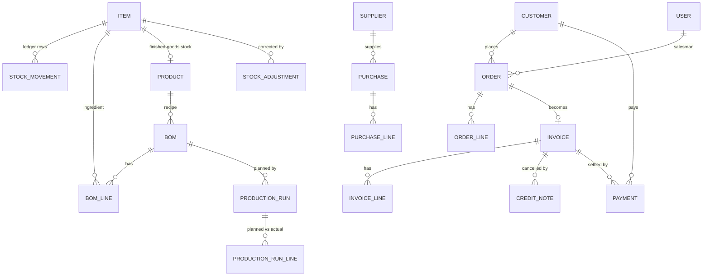

# Design note

## 1. Data model

`STOCK_MOVEMENT` is the heart: `(item, qtyDelta, unitCost, type, sourceType, sourceId, occurredAt)`. `sourceType/sourceId` points to a purchase, production run, invoice, credit note or stock adjustment, so every movement is traceable. `AUDIT_LOG(entity, entityId, action, userId, before, after, at)` records edits.

Conventions: quantities are integers in base units (g, ml, pcs; 40 kg = 40000); money is integer paise; unit cost is a `NUMERIC(18,6)` of paise per base unit, so ₹45/kg is exactly 4.5 paise/g. No floating point is used for money or stock.

## 2. Stock and BOM computation

**Balance** of any item = `SUM(qtyDelta)` over its ledger rows. There is no balance column to overwrite, so opening + receipts − issues ± adjustments = closing holds by construction, and the stock summary report is the same sum split by movement type.

**Production run** (one serializable transaction):
1. For each BOM line, `planned = qtyPerBatch × batches` is snapshotted next to the `actual` entered by the supervisor.
2. The run is refused if any material balance is below the actual issue (no negative stock).
3. Each issue writes a negative ledger row valued at the item's weighted-average cost; good output writes a positive finished-goods row.
4. `variance % = (actual − planned) / planned × 100` per material, and for yield (`expectedOutput = expectedYield × batches` vs good packets). A line is flagged when `|variance| > tolerance` (3%, strictly greater). Oil: (10.5 − 10) / 10 = +5%. Yield: (188 − 200) / 200 = −6%.

**Units**: the user types kg, L or pieces; `displayFactor` (1000 for kg and L) converts to base units on the server. Input finer than one base unit is rejected instead of rounded.

**Sales**: dispatch writes a negative finished-goods row at the current average cost. Before approval, availability is `ledger balance − quantity promised to other approved or invoiced orders`; a shortage rolls back the approval.

## 3. Costing and valuation

**Method: moving weighted average.** On each receipt the average becomes `(old value + receipt value) / new quantity`; issues leave it unchanged. Example: 100 kg @ ₹42 + 60 kg @ ₹45 gives ₹43.125/kg, so 40 kg of flour costs ₹1,725.00. It was chosen because purchases at different rates share one bin, so tracking layers (FIFO) adds effort without a benefit at this scale.

**Overheads**: labour, power/gas and other costs recorded against a run are spread equally over the run's good packets.

`cost per packet = (Σ actual quantity × average cost + overheads) / good packets`

Benchmark: materials ₹4,055.00 + overheads ₹1,800.00 = ₹5,855.00; ÷ 188 = ₹31.14. Margin against ₹50 is ₹18.86 (37.71%). Because actual (not planned) quantities are used, wastage and damaged pouches raise the cost of good packets, which is the point of showing it.

## 4. Integrity, GST and audit

- **Transactions:** every posting (purchase, run, approval, invoice, dispatch, payment, adjustment) runs in one database transaction at serializable isolation; invoice numbers per financial year rely on this plus a unique constraint.
- **Idempotent orders:** the phone generates a `clientRef`; a retry after a dropped connection returns the existing order instead of creating a duplicate.
- **GST:** tax is computed per rate on the invoice taxable value, rounded half-up to whole paise. Same state as the factory: CGST = SGST = half the rate each; otherwise IGST. ₹7,500 × 5% → ₹187.50 + ₹187.50.
- **Cancellation:** a posted invoice is never deleted. A credit note reverses it, and the original stock can be returned at its dispatch cost. Outstanding = invoices − credit notes − payments.
- **Audit trail:** order edits, invoices, production runs, payments, master changes, users and adjustments are written to `AUDIT_LOG` with user, time and before/after values.
- **Access:** each API route lists the roles allowed; the role and active flag are re-read from the database on every request.
